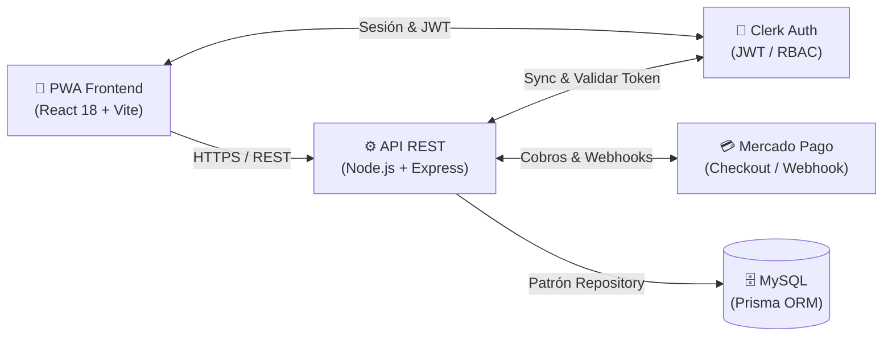

# 🚗 Sistema de Gestión de Estacionamiento Medido


Plataforma integral (**PWA móvil + API REST**) para la gestión, fiscalización y cobro de estacionamiento medido en vía pública. Diseñada con arquitectura por capas, control de acceso basado en roles (RBAC), mapas interactivos y pagos digitales.

---

## Funcionalidades Principales

* **🚗 Conductor (PWA Mobile):** Registro de patentes, geolocalización de zonas tarifadas en mapa interactivo, inicio/fin de sesiones de estacionamiento con cobro por tiempo, recarga de saldo mediante **Mercado Pago** y pago de infracciones.
* **👮 Inspector de Tránsito:** Consulta inmediata de patentes en calle (< 30s) para verificar sesiones activas y emisión de multas con regla de negocio anti-duplicados (máx. 1 infracción cada 30 min).
* **⚙️ Administrador:** Delimitación de polígonos de zonas sobre el mapa con **Leaflet**, fijación de tarifas por hora, horarios de vigencia y alta de inspectores.

---

## Demostración en Video

Videos del funcionamiento real del sistema disponibles en [`demos/`](demos/):

| Módulo / Rol | Video Demostrativo |
|:---|:---|
| 🚗 **Conductor** | [▶️ Iniciar sesión de estacionamiento](demos/vista_conductor_iniciar_estacionamiento.mp4) · [▶️ Cargar saldo con Mercado Pago](demos/vista_conductor_cargar_saldo.mp4) |
| 👮 **Inspector** | [▶️ Verificación de patente en calle y multas](demos/vista_inspector.mp4) |
| ⚙️ **Administrador** | [▶️ Gestión de zonas en el mapa y tarifas](demos/vista_administrador.mp4) |

---

## Arquitectura del Sistema

El sistema implementa un **monolito modular por capas** (Routes $\rightarrow$ Controllers $\rightarrow$ Services $\rightarrow$ Repositories $\rightarrow$ Prisma ORM) aislando la lógica de negocio del acceso a datos (Patrón Repository e Inversión de Dependencias).


---

## Puesta en Marcha

### 1. Backend (`/backend-estacionamiento`)
```bash
npm install
cp .env.example .env    # Configurar DATABASE_URL, Clerk y Mercado Pago
npx prisma migrate dev  # Aplicar migraciones
npm run dev             # Servidor en http://localhost:3000
```

### 2. Frontend (`/frontend-estacionamiento`)
```bash
npm install
cp .env.example .env    # Configurar VITE_CLERK_PUBLISHABLE_KEY y VITE_API_URL
npm run dev             # Aplicación en http://localhost:5173
```

---

## Créditos

Proyecto desarrollado para la cátedra de **Arquitectura y Diseño de Sistemas (2026)** de la **Universidad Nacional del Sur (UNS)**.

**Equipo:** Ignacio Cordiglia · Juan Segundo Gencarelli · Franco Martinez Palmieri · Juan Francisco Picciotti · Maria Yametti · Agustín Yerba.
